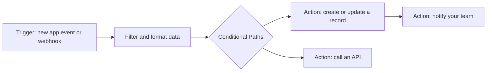

# FastHook

### Connect apps. Build workflows. Automate everyday work.

FastHook is a workflow automation platform for connecting apps, moving data between tools, and turning repetitive tasks into multi-step automations. Build visually with **Triggers, Actions, Filters, and Paths**, or describe your process to the AI assistant and review the proposed workflow.

If you have used Zapier, the starting point will feel familiar: **when something happens in one app, perform actions in others**. FastHook brings that model together with data transformations, webhook tooling, and detailed execution history.

[Start building](https://dashboard.fasthook.io/workflow) · [Website](https://www.fasthook.io) · [Templates](https://www.fasthook.io/templates) · [Integrations](https://www.fasthook.io/integrations) · [Documentation](https://www.fasthook.io/docs) · [Pricing](https://www.fasthook.io/pricing)

## From an event to a finished task

A Workflow starts with one Trigger. Each new matching event supplies data to the steps that follow. Map fields from the Trigger or earlier steps, choose which routes should run, and inspect the result in Workflow Audit.

## What you can build

These are examples of processes you can configure using the available Triggers and Actions:

| Process | Example workflow |
| --- | --- |
| Save email attachments | Gmail attachment → format received date → find or create a Google Drive folder → upload and share the file → notify Telegram. |
| Keep your team informed | New Google Sheets row → Filter → Slack message. |
| Coordinate project updates | Trello event → send updates to Slack, Discord, or Telegram. |
| Process incoming webhooks | Webhook → transform the payload → choose a Path → call an API or run an app Action. |

Start from an [automation template](https://www.fasthook.io/templates) or build your own. The [integration catalog](https://www.fasthook.io/integrations) lists available app operations and setup requirements.

## Build visually or with AI

- **Visual workflow builder** — connect a Trigger to multiple steps and conditional routes on one canvas.
- **AI assistant** — describe an automation or ask for a workflow change, review the proposal, and complete account connections and required fields in the editor before activation.
- **Reusable templates** — start with an existing automation and adapt its apps, resources, and mappings.
- **Step testing** — inspect trigger samples and test configured steps before activating a Workflow. Tests that run Actions can create real records, files, or messages.
- **Lifecycle controls** — keep work in Draft, activate it for new events, or pause it when needed.

## Control the data and execution

| Capability | What it does |
| --- | --- |
| **App and webhook Triggers** | Start a Workflow from supported provider activity or an incoming HTTP request. Delivery modes depend on the provider. |
| **App Actions** | Send messages, create or update records, work with files, and perform other named provider operations. |
| **Data mapping** | Pass values from the Trigger and earlier steps into later Action fields. |
| **Filters** | Continue a route only when its conditions match. |
| **Paths** | Route an event through named conditional branches. |
| **Formatter** | Transform dates, numbers, text, lookups, and lists without writing code. |
| **JavaScript transformations** | Apply custom payload logic with reusable transformations. |
| **JSON Patch** | Modify structured data with RFC 6902 operations. |
| **Loops** | Process array items with per-item mappings and inspect their results. |
| **Delays** | Defer a route before continuing. |
| **Destinations** | Deliver data through a reusable HTTP or transport configuration. |
| **Error routes** | Follow a recovery or notification route when a step fails. |

## Connect the apps you use

Explore integrations for Google Workspace, Slack, Telegram, Discord, GitHub, Trello, Notion, Airtable, CRM tools, and other services in the [live catalog](https://www.fasthook.io/integrations).

Choose an app's supported Trigger or Action, connect the required account, and select the target resources. Trigger availability, Action operations, authentication methods, and permissions vary by integration.

For services outside the catalog, use a **Webhook Trigger** to receive events or an **HTTP Action / Destination** to call an API.

## Create your first automation

1. Open [Workflows](https://dashboard.fasthook.io/workflow) and select **New Workflow**, or choose a [template](https://www.fasthook.io/templates).
2. Choose an app event or Webhook Source as the **Trigger**.
3. Add an **Action**, connect its account, and choose the operation and target.
4. Map the Trigger's fields into the Action. Add more steps, Filters, or Paths as needed.
5. Test with representative data and review the inputs, outputs, and resulting changes in your apps.
6. **Activate** the Workflow, produce a new event, and inspect the run in **Audit**.

Only active Workflows process new events. Activation does not automatically backfill events that happened while a Workflow was inactive.

Follow the [complete quickstart](https://www.fasthook.io/docs/quickstart) for a guided walkthrough.

## See what happened in every run

Workflow Audit connects the event that started an automation to the steps that processed it:

- Inspect Trigger data, mapped inputs, Action outputs, and provider errors.
- See which steps succeeded, failed, or were skipped and which routes were selected.
- Identify the Workflow version used by a run, even after the graph changes.
- Inspect loop iterations when processing collections.
- Diagnose the first failed step before changing the automation.

Temporary failures may retry according to runtime and provider behavior. External Actions should tolerate retries where repeated calls could create duplicate side effects. See [Runs and errors](https://www.fasthook.io/docs/runs).

## Webhook tools for custom integrations

FastHook also includes dedicated webhook Sources, request inspection, payload transformations, delivery history, retries, and replay tooling. Use them to connect custom systems and investigate HTTP traffic alongside app automations.

See [Webhook infrastructure](https://www.fasthook.io/webhook-infrastructure) and [Webhook replay](https://www.fasthook.io/webhook-replay) for delivery and recovery workflows.

## Learn more

- [Workflows](https://www.fasthook.io/docs/workflows) — builder, step types, lifecycle, and execution behavior.
- [Triggers](https://www.fasthook.io/docs/triggers) and [Actions](https://www.fasthook.io/docs/actions) — start automations and perform work in connected apps.
- [Data mapping](https://www.fasthook.io/docs/data-mapping) — pass data between steps.
- [Paths and conditions](https://www.fasthook.io/docs/paths) — choose execution routes.
- [Connected accounts](https://www.fasthook.io/docs/connected-accounts) — configure provider authentication.
- [Workflow versioning](https://www.fasthook.io/docs/workflow-versioning) — understand saved graph versions and run history.
- [Pricing](https://www.fasthook.io/pricing) — review current plans and limits.

## About this repository

This public repository is the FastHook product overview and entry point for documentation, integrations, and templates. It does not contain the application source code or a self-hosted distribution.

FastHook is under active development. Available integrations, operations, and limits may evolve; consult the product and documentation for current behavior. Bug reports and focused feature requests are welcome through [GitHub Issues](https://github.com/alencmanis/fasthook.io/issues).

## License

This repository does not currently include an open-source license. Unless a specific FastHook repository states otherwise, its code and content remain subject to applicable copyright law.
